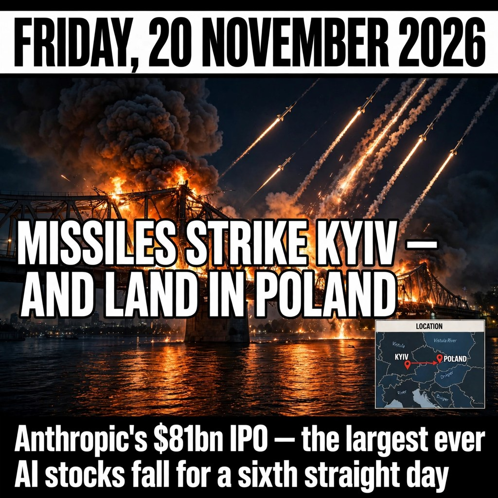

# Friday, 20 November 2026 — in one image

One dramatic poster that sums up the world's news of Friday, 20 November 2026.

## The day's news

- **Missiles strike Kyiv — and land in Poland** — Russia fires 400+ drones and 110 missiles at Ukraine overnight; three bridges over the Dnipro are hit, and two missiles plus a drone come down inside NATO member Poland.
- **Anthropic's $81bn IPO** — the largest IPO on record; shares close 17% above the offer price.
- **AI stocks fall for a sixth straight day** as the AI trade unwinds; Bitcoin nears $61,700.

## How it works

`entry.png` is the image (1024×1024, under 1 MiB). `main.ts` (Node 22, standard library only) checks it against the gate's limits and copies it to `/output/entry.png`, where the judge reads it.

Built for the [make.fun](https://make.fun) news-image-20261120 bounty.

## License

MIT
